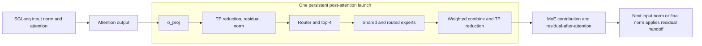

# MiniMax-M3.1-Flash: fuse the post-attention path while retaining framework attention

The model wrapper retains SGLang attention and runs the remainder of each sparse layer as one
persistent FlyDSL kernel. The fused boundary starts at the **unprojected attention output** and
returns the reduced MoE output plus the residual after attention. It is not a whole-layer or
whole-model single launch.

Source pin: sgl-amd-mono `7a4a552db119d1c3689165a182f151388a636272`.
This case covers the target decode/verify path and its state handoff, not a draft-model implementation.

## Admission and representation

| Field | Pinned-source scope |
|---|---|
| Device / TP / rows | gfx950, TP4, up to 16 rows; 57 sparse layers in the model described by the repository |
| Input/output boundary | BF16 attention output and residual; reduced MoE contribution and residual-after-attention returned separately |
| Precision | NVFP4-expert checkpoint; routed expert views use the post-load AITER FP4/scales contract; the shared expert keeps its MXFP8 values |
| Other computation | Per-token FP8 output projection with rowwise-FP8 weights; FP32 router and model-specific norm/activation/weighting order |
| Runtime | Compiled occupancy is checked for every admitted width; spec/config checks and framework routing still apply |
| Version limits | Plugin source fixed; no installed SGLang/AITER/FlyDSL/ROCm environment or benchmark run is recorded |

The spec advertises speculative/ragged verification support because the fused FFN boundary reads no
KV; this does not certify every draft algorithm or an arbitrary deployment. Sources:
[boundary](../../_sources/sgl_amd_mono_7a4a552d.md#m31_boundary),
[build and capabilities](../../_sources/sgl_amd_mono_7a4a552d.md#m31_build).

## Semantic graph and launch boundary

`_Built._backbone` temporarily captures the input to `o_proj`, executes the framework attention,
then calls `FfnRunner`. Inside `run_ffn`, push/reduce/norm/router/route/up/down/final are stage
functions inside one kernel body, not eight separate GPU dispatches.
The kernel uses the common 256-CTA, 512-thread geometry and tagged scratch/peer transfers.
See [live call](../../_sources/sgl_amd_mono_7a4a552d.md#m31_call),
[stage semantics](../../_sources/sgl_amd_mono_7a4a552d.md#m31_stages), and
[device body](../../_sources/sgl_amd_mono_7a4a552d.md#m31_body).

## Buffers, progress and numerical boundaries

| Item | Contract |
|---|---|
| Returned output/residual | The caller writes the residual stream and records MoE output with `PLAIN_ADD`; the next norm performs the remaining residual addition |
| Padding slots | Negative slots still run the seam, join no expert and yield zero MoE output; the padding residual is unspecified |
| Per-width scratch | Materialized for each compiled width; stage intermediates are not all kept in registers |
| Peer storage and epochs | Runners sharing a peer buffer share its epoch; ranks must execute compatible launch sequences |
| Residency | `warm` queries the compiled kernel's active blocks per CU and rejects a width if capacity is below the full grid |
| Tag reuse | Completion marks precede epoch advance; reused 16-bit tag cycles are cleared only after the relevant readers finish |

An all-resident grid is a requirement of this schedule, not sufficient proof that every possible
synchronization change makes progress. Sources:
[runner](../../_sources/sgl_amd_mono_7a4a552d.md#m31_runner),
[occupancy query](../../_sources/sgl_amd_mono_7a4a552d.md#m31_residency),
[tag lifecycle](../../_sources/sgl_amd_mono_7a4a552d.md#m31_epoch).

The spec declares tolerance-based comparison, including different envelopes for the residual and
MoE output. Its comments distinguish rows routed alike from routing disagreements. Preserve the
router order, bias, scaling and rounding points; do not describe the path as bit-exact or silently
transfer its tolerances to another model. A new precision/fusion experiment also needs serving accuracy.

## Measurement and remaining scope

The embedding, dense layers, attention, final norm and logits stay in the surrounding SGLang forward.
The one-launch count applies to the post-attention boundary on each sparse layer and rank. Allocation,
copies, epoch/setup operations and graph replay overhead need their own accounting in a serving trace.

This pass inspects implementation and [test definitions](../../_sources/sgl_amd_mono_7a4a552d.md#m31_tests).
It runs no GPU tests and encodes no numerical performance comparison. Effect and independent-attribution
confidence are **unknown**. Compare the entire post-attention boundary against the ordinary path,
then separately report full-step or serving effects under matched inputs, TP and precision.

Reusable decisions: [residual/padding handoff](../corpus/decisions.md#post-attention-preserve-handoff),
[compiled residency](../corpus/decisions.md#post-attention-gate-compiled-residency),
[peer-buffer epochs](../corpus/decisions.md#post-attention-peer-buffer-epochs).
Return to [attention output through MoE](../README.md).
