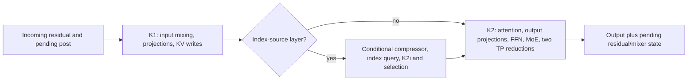

# DeepSeek-V4.1-Flash: layer fusion with a retained cache-publication boundary

The pinned implementation runs each covered layer's main computation as K1 followed by K2. An
index-source layer can execute a compressor, index-query work, K2i and selection between them.
**Two core launches is not a total launch count for every layer or serving step.**

This review covers the target model path at sgl-amd-mono commit
`7a4a552db119d1c3689165a182f151388a636272`. It does not include the separate DSpark draft kernels
or a measurement of the optional step-glue replacements.

## Admission and implementation

| Field | Pinned-source scope |
|---|---|
| Device / TP | gfx950, TP2 or TP4; declared widths 1..48 rows |
| Phase | Decode and eligible DSpark target verify; rows are not necessarily request count |
| Backend | FlyDSL persistent kernels; SGLang owns surrounding framework work |
| Interface | BF16 model interface; FP8 KV, model-specific MXFP4 experts and FP8 shared-expert handling |
| Gates | `dsv4` attention; AITER FP8-GEMM layout; `SGLANG_DSV4_KV_LAYOUT=v4`; real model routing; further model/config checks in the spec |
| Version limits | The plugin commit is fixed; installed SGLang, AITER, FlyDSL and ROCm versions were not captured by this source review |

The spec is an admission contract, not evidence that a particular serving run engaged the path.
See [admission](../../_sources/sgl_amd_mono_7a4a552d.md#dsv41_admission) and
[the live caller](../../_sources/sgl_amd_mono_7a4a552d.md#dsv41_call).

## Semantic graph and actual execution

The semantic layer performs input mixing/projection, position/cache preparation, sparse/window
attention, output projections, FFN mixing, routing, shared/routed experts and TP completion.
Its external state includes cache writes and the pending residual/mixer representation.

`spec._launch` calls `runner.k1`, conditionally `_select`, then `runner.k2`.
`DSV41MonoRunner.k2_kernel` selects `build_mono_k2`; that body invokes the attention back and
`run_ffn` before one device launch. The separate `build_mono_ffn`/`runner.ffn` path is used as a
kernel-check reference and is not a third FFN launch in this forward.

The pinned spec explains K1-to-K2 as a device-wide release for KV records read across K1 workgroups
on gfx950. Preserve this source-specific visibility requirement when considering a single-launch
replacement; an intra-CTA barrier is not a substitute. Sources:
[boundary](../../_sources/sgl_amd_mono_7a4a552d.md#dsv41_boundary),
[K2 body](../../_sources/sgl_amd_mono_7a4a552d.md#dsv41_body),
[runner](../../_sources/sgl_amd_mono_7a4a552d.md#dsv41_runner).

## Materializations and state ownership

| Value / state | Producer and next consumer | Required boundary |
|---|---|---|
| SWA KV records and key tables | K1 -> K2 attention | Correct slot, byte layout and visibility across producers; pad rows use the reserved dummy slot |
| Normed input, query and compressed/index data | K1 / SGLang compressor / K2i -> selector and K2 | Some work remains outside K1/K2; selection rewrites the ratio's sparse-index state |
| Pending `(x, residual, post, comb)` and pre-mix | K2 -> next layer or final head | Fold/settle once; first layer, Engram and final-head boundaries differ |
| Token-parallel rows / DSpark captures | Owning rank -> final gather/consumer | From 12 rows when divisible by TP, local residual/mix rows alone are incomplete |
| Scratch and launch outputs | Runner -> subsequent stages/launches | Global buffers remain materialized; fusion does not imply zero intermediate traffic |

`_select` has identity, full, producer and reindex cases; a compressed source without an indexer
can return after compressor work. An identity selector need not run the score kernel. Document the
actual branch before assigning a fixed launch total.
See [selection](../../_sources/sgl_amd_mono_7a4a552d.md#dsv41_select) and
[model forward](../../_sources/sgl_amd_mono_7a4a552d.md#dsv41_forward).

## What remains around the fused layer

SGLang input preparation, embedding, Engram operations, final combine/norm and logits remain in the
model forward. Token-parallel completion and auxiliary captures can require a final gather. Glue
installation also affects metadata/accept/inject work; those changes are outside this case's kernel
comparison. A full-step profile must count the work that actually runs, including copies and helpers.

## Evidence and experiment boundary

This is source inspection. [K2 test sources](../../_sources/sgl_amd_mono_7a4a552d.md#dsv41_tests)
identify a validation route, but were not executed here. There is no encoded before/after trace,
latency, eliminated-launch count or isolated fusion-speedup result. Effect and independent-attribution
confidence are **unknown**; this is not a zero-gain conclusion.

For a new model, compare the same row count, context, TP, precision and cache/routing contract.
Check returned values, every KV mutation, residual handoff and captured state across graph replay.
Trace index-source and window-only layers separately, then measure the full layer and serving step.

Reusable decisions: [cache publication](../corpus/decisions.md#layer-preserve-cache-publication-boundary),
[conditional launch accounting](../corpus/decisions.md#layer-count-conditional-indexer-work),
and [deferred residuals](../corpus/decisions.md#layer-deferred-residual-ownership).
Return to [decoder layers](../README.md).
