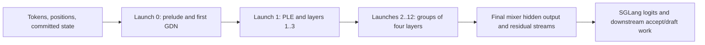

# Qwen3.8-Flash-Next: bounded cross-layer fusion for target verification

The target implementation partitions 48 hybrid GDN/QSA layers into **13 persistent stack launches**
on one GPU. SGLang's logits processor remains outside this count, as do the host-issued epoch update
and other setup/serving operations. This is a source-level launch plan, not a profiler-measured total
for the whole verify/accept/draft step.

Source pin: sgl-amd-mono `7a4a552db119d1c3689165a182f151388a636272`.
The repository also has a separate MTP draft implementation; this review is scoped to target verify.

## Admission and computation

| Field | Pinned-source scope |
|---|---|
| Hardware / parallelism | gfx950, TP1; the spec rejects PP/CP/EP arrangements outside its supported single-GPU setup |
| Phase / rows | NEXTN target verify, resolved to EAGLE: top-k 1, three draft steps, four tokens/request; 1..8 requests (4..32 rows) |
| Precision | BF16 interface; MXFP4 experts; FP8 attention/GDN projections and PLE n-gram table; FP32 or BF16 GDN state |
| Spec gates | Supported `triton`/`aiter` framework attention setup, fused shared expert, compatible cache/weight layouts; ReplaySSM and PP speculative remapping excluded |
| Fallback | The target forward falls back to the original model for unsupported mode/request shape; more admission checks apply before build |
| Version limits | The plugin commit is fixed; installed SGLang, AITER, FlyDSL and ROCm revisions are not established here |

See [target forward](../../_sources/sgl_amd_mono_7a4a552d.md#qwen_spec) and
[admission](../../_sources/sgl_amd_mono_7a4a552d.md#qwen_admission).

## Semantic graph versus physical launches

The model combines recurrent GDN layers and sparse full-attention QSA layers with hyper-connection
mixers, MoE blocks, PLE state and an n-gram prelude. Each fused launch contains static layer/stage work.

| Persistent launch | Layer composition | Extra work inside the launch |
|---|---|---|
| 0 | Layer 0, GDN | PLE n-gram prelude and token embedding reads |
| 1 | Layers 1..3, GDN/GDN/QSA | PLE block before layer 1 |
| 2..12 | Four layers each: 3 GDN + 1 QSA, layers 4..47 | Launch 12 ends with the model-level HC mixer |

`launch_plans` defines these groups; `VerifyRunner.launch` invokes each compiled kernel in order,
ping-pongs residual buffers, then issues `epoch[:1].add_(1)`. The latter is a separate framework
operation and must not disappear from full-step accounting.
Sources: [plan](../../_sources/sgl_amd_mono_7a4a552d.md#qwen_plan),
[launch loop](../../_sources/sgl_amd_mono_7a4a552d.md#qwen_launch).

Within a GDN layer, projection feeds causal-convolution/gated-delta computation, then gated norm and
output projection. Within QSA, projection/cache preparation feeds index scores, exact block selection,
split attention and partial merging. Both continue through the MoE-side mixer, router, gate/up and down
stages. These stage calls share a launch; they are not individual launches.
See [stage sequence](../../_sources/sgl_amd_mono_7a4a552d.md#qwen_stages).

## Stage handoffs and progress

The 256 CTAs of 512 threads walk a static stage order; the design relies on co-residency and dependencies
pointing to earlier stages. Inter-stage values are **materialized in global scratch** as 8-byte
payload/tag pairs. A payload is FP32 bits or a pair of BF16 values; the other word identifies the
step and launch (`step * LAUNCH_SLOTS + launch_id + 1`, with 64 launch slots in this source).

The publisher stores the pair together using device-scope cache policy. A consumer polls its required
pairs until their tags match, using guarded waits. This avoids treating a previous step's scratch as
current data under the valid tag lifetime; it does not eliminate scratch traffic. Reuse or wrap changes
need their own lifetime review. A TP1 handoff does not implement a cross-GPU collective.
Sources: [mailbox code](../../_sources/sgl_amd_mono_7a4a552d.md#qwen_mailbox),
[guarded wait](../../_sources/sgl_amd_mono_7a4a552d.md#qwen_wait).

## State visible outside the stack

| State | Required behavior |
|---|---|
| GDN / convolution / PLE / n-gram verify scratch | Store state after each draft position in the request's scratch row for later accept/commit |
| Committed GDN and PLE state | Keep distinct from speculative scratch; the target verify path does not simply overwrite it with the last draft state |
| KV and QSA index state | Preserve slot writes, index-key ring positions, compressed keys and causality across a request's verify tokens |
| Residual and final hidden buffers | Return the representation consumed by logits and the MTP draft |
| Positions | Use sequence position for context/causal logic; use MRoPE coordinates for rotary transforms when different |
| Padding | Follow the reserved dummy KV slot and request-row conventions; do not treat graph padding as a live request |

The state contract is described in the
[pinned implementation guide](../../_sources/sgl_amd_mono_7a4a552d.md#qwen_state);
the [GDN recurrence body](../../_sources/sgl_amd_mono_7a4a552d.md#qwen_recurrence)
reads committed state and writes per-token snapshots through the verify-scratch pointers.

## Fusion depth and measurement

The documentation gives compile-time unrolling, code size and FlyDSL compilation cost as reasons for
bounded layer groups. The number 13 is not established as optimal for another model or compiler.
Compare cold compilation/cache reuse separately from warm stack latency and serving throughput.
Sources: [partition rationale](../../_sources/sgl_amd_mono_7a4a552d.md#qwen_partition) and
[test definitions](../../_sources/sgl_amd_mono_7a4a552d.md#qwen_tests).

No GPU tests, before/after launch traces or performance ablations were run in this review. Effect
and independent-attribution confidence are **unknown**. A new-model experiment should verify every
state mutation and the following accept/draft step, then measure complete stack and full-step costs.

Reusable decisions: [tagged mailboxes](../corpus/decisions.md#stack-tagged-stage-mailboxes),
[verify-state preservation](../corpus/decisions.md#stack-preserve-verify-state),
[bounded fusion depth](../corpus/decisions.md#stack-bound-fusion-depth).
Return to [decoder stacks](../README.md).
