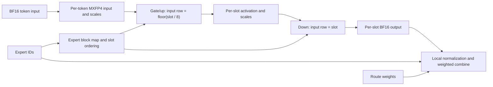

# Muse Spark: reuse quantized token inputs across expert routes

The inspected compact MoE path quantizes the input once per token on each rank and lets selected experts reference it through routing-slot IDs. Expert-dependent activations and outputs use per-slot storage. This is a dataflow contract that can be understood independently of the path's [fusion boundaries](muse_spark_decode.md); no kernel change or speedup is claimed here.

**Evidence:** `moe_source`, `moe_metadata`, `c8_environment`, `c8_report` in the [source ledger](../../_sources/muse_spark_c8.yaml). See the [shared context](../../_sources/muse_spark_c8.md) for TP8/EP8, image digest, graph mode and extraction limits.

## Inspected dataflow

`compact_a4_experts` receives BF16 input `x[M,4096]` and expert IDs `[M,8]`. `_prepare_a4` writes packed MXFP4 input `q[M,2048]` and scale bytes `qs[M,128]`. Each group of 32 input values shares an E8M0 scale. `_scatter_a4` builds an expert-ordered list of token-major routing-slot IDs.

For a slot `s`, `_expert_a4` selects `src = s // 8` for gate/up computation (`ACT=True`) and `src = s` for down computation (`ACT=False`). The former reuses the token input; the latter consumes the expert-dependent activation produced for that exact slot.

The input transform is shared only before expert-specific computation. Different expert weights make gate/up activations distinct, so applying the same reuse to those activations would change the computation. This source reuses input within each rank; it does not establish cross-rank sharing of its quantization buffer.

## Worked storage example

Take `M=8`, hidden width 4096 and top-k 8. These are valid source dimensions and `M=8` is an extraction metadata bucket. The following numbers are **derived allocation sizes**, not measured traffic or an optimization A/B:

| Input representation | Packed values | Scale bytes | Total |
| --- | ---: | ---: | ---: |
| Inspected per-token buffer: 8 rows | `8 * 2048 = 16,384 B` | `8 * 128 = 1,024 B` | **17 KiB** |
| Hypothetical fully expanded input: 64 routing-slot rows | `64 * 2048 = 131,072 B` | `64 * 128 = 8,192 B` | **136 KiB** |

The inspected input representation is one eighth the size of that hypothetical fully expanded buffer. The comparison excludes expert weights, metadata, intermediate activations, outputs and allocator overhead. It does not assert that an existing baseline allocated the expanded buffer or that every route is local. A compact buffer holding only local routes would be a different comparison.

Several workgroups can reread the same quantized token, so an eightfold representation-size difference does not imply eightfold less HBM traffic or an eightfold speedup. No launch is removed by this accounting argument.

## Buffer ownership and lifetime

| Buffer | Allocated representation | Producer → last consumer | Required rule |
| --- | --- | --- | --- |
| `q`, `qs` | `[M,2048]` and `[M,128]`, uint8 | Preparation → gate/up | Preserve per-token values/scales together |
| Slot and expert maps | Capacity-padded int32 arrays | Preparation/scatter → down | Preserve sentinels and expert-local slot identity |
| `inter`, `inter_scale` | `[8*M,2048]` and `[8*M,128]`, uint8 | Gate/up → down | Read the same expert slot, not `slot // 8` |
| `y` | `[8*M,4096]`, BF16 | Down → finalizer | Only local expert slots are valid for consumption |
| Local result | `[M,4096]`, BF16 | Finalizer → external caller | Remains a rank-local contribution |

At `M=8`, the allocated expert activation/scales still occupy 136 KiB and `y` occupies 512 KiB. Those sizes are also logical allocation calculations; the input reuse does not eliminate these per-slot buffers.

The finalizer checks whether the selected expert belongs to the local range before reading `y`. Nonlocal slots can remain unwritten. Replacing that finalizer with a consumer that reads all allocated rows, or reusing scratch before its last reader completes, would violate the dataflow contract.

The wrapper allocates these tensors with `torch.empty`. It does not implement an explicit persistent shared workspace. Reusing scratch is a possible future experiment, subject to last-consumer ordering, graph address stability and concurrent-call isolation. The allocation statements alone do not establish a repeated graph-replay allocation cost.

## Scheduling and communication

The inspected path retains five ordered launches: preparation, scatter, gate/up, down and finalizer. Preparation produces the offsets needed by scatter; expert computation needs both the quantized input and maps; finalization waits for expert output. The finalizer is launched on the current stream. No inter-stage overlap is established by this source.

For local expert counts `c_e`, block height 16 requires `sum_e(16 * ceil(c_e / 16))` padded rows. The source's launch capacity uses `cap = 8*M + 32*(16-1)` and `nb = ceil(cap/16)`; unused expert blocks are guarded. Routing skew can change useful work, padding and weight reuse even when the five-launch structure and capacity grid stay the same.

`run_compact_a4` returns the normalized, route-weighted local contribution before TP reduction. The distributed reduction is outside the inspected wrapper. Inspect its caller before claiming a particular collective schedule or overlap; preserve per-expert normalization and route-weight semantics when changing this boundary.

## Dispatch, evidence and proposed measurement

The source predicate accepts `0 < M <= 512`, multiples of eight, hidden width 4096 and the exact packed weight/scale shapes for 32 local experts. The wrapper requires BF16 input and `[M,8]` IDs and raises on ineligible input. The extraction metadata includes verification buckets such as `M=8,16,24`; that evidence does not demonstrate the full supported envelope or define a caller fallback.

The extraction used synthetic inputs/weights and reconstructed routing, with frozen-baseline and dense-dequant reference checks described in its metadata. This entry adds no GPU correctness or timing run. Its conclusions are source-observed token/slot ownership, ordering and eligibility, plus the explicit arithmetic above.

To evaluate a proposed scratch-reuse or alternative routing-layout implementation, compare the complete local callable at identical shapes, routing, graph mode and numerical contracts. Include map construction, quantization, scatter and finalization; record cache policy, latency/noise and peak live storage. Exercise skew and nonlocal/unwritten slots. Such an experiment can retain the same five launches; record any change to the launch structure. Measure distributed completion and serving separately before claiming a broader benefit.

Related topic pages: [dataflow and memory](../dataflow.md), [scheduling and communication](../scheduling.md), [dispatch](../dispatch.md), [measurement](../measurement.md). This case follows the [workload template](../../_templates/workload_case.md).
